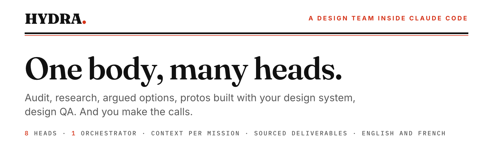
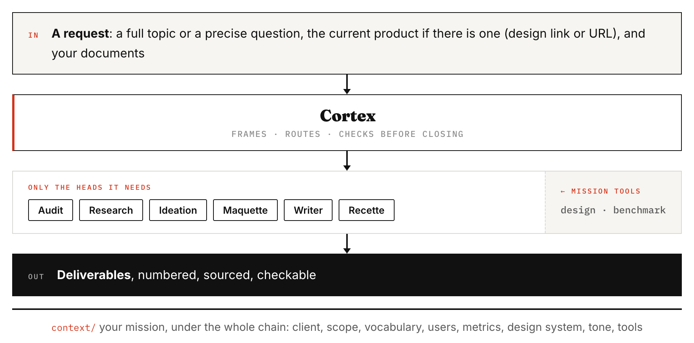

<picture>
  <source media="(prefers-color-scheme: dark)" srcset="docs/assets/banner-dark.png">
  
</picture>

<p align="center">
  <a href="https://mcqx7.github.io/hydra-agent/presentation.en.html"></a>
  <a href="https://github.com/MCQX7/hydra-agent/releases/latest"></a>
  <a href="LICENSE"></a>
  
  
  
</p>

<p align="center"><b>English</b> · <a href="README.md">Français</a></p>

---

You give Hydra a topic: an existing screen, some documents, a problem. It takes it from
start to finish. It audits what exists, looks at what others do, suggests options and
critiques them, builds protos with your design system, checks the copy, and can also
check a build against the design. It does the work of a small team around you, and you
make the decisions.

It won't tell you what you want to hear. If an idea is weak, it says so and explains
why. Every claim cites its source. If data is missing, it says so instead of making it
up.

## How it works

<picture>
  <source media="(prefers-color-scheme: dark)" srcset="docs/assets/flow-dark.png">
  
</picture>

Cortex frames your request and only calls the heads it needs. Audit and research make
up the discovery phase: audit looks at what you have, research looks at what others do.

## What a topic produces

| Deliverable | What it holds |
|---|---|
| `01-topic-sheet` | The framing: the problem, the metric that will decide and its threshold, the people affected, the scope, the renders (mobile, desktop) and what is already decided. |
| `02-report` | Findings on what exists, hypotheses, references, options with their critique, then the recommendation. Every claim points to its source. |
| `03-brief` | For each option: what the screen must show, with which components, and a composition prompt anyone can reuse in their own tool. |
| `explorations/` | The gallery: one HTML proto per option, which you can click through, in your platform's renders. |
| Design QA | For the developer: one table per area of the screen, on desktop and mobile, with the expected value, the value measured on the build, the severity and an annotated screenshot. |

You choose how the topic runs. **In one go**: Hydra goes all the way and writes down
what it had to assume. **Step by step**: it stops at the key moments so you can decide.
For the protos, which cost the most, you also choose when: **straight away**, or **after
reading the brief**, if the options are worth it. Hydra asks you both questions when
framing.

## Language

Hydra works in your language. It talks to you and writes its deliverables in your
mission's language, which the welcome session sets with you; French is the default. In
English, everything follows: the headings, the deliverables' names (`01-topic-sheet`,
`02-report`, `03-brief`) and the rendered pages. In another language, the text is in
your language and the headings stay in English.

The copy in the protos follows your product's language, which can be a different one.
The method itself is written in French (the rules, the heads, the tools' messages), but
you never need to read it. Just write to Hydra in English from your very first message.

## Getting started

**You need:**
- **Claude Code**, ideally with **Opus**. Hydra is tuned for Opus at high effort (the
  design QA at medium effort), based on side-by-side tests. It also works with Sonnet or
  a lower effort if your plan doesn't allow more, but its deliverables are weaker.
- **Node.js 22** or later, and **Google Chrome** (or Chromium). The tools are Node
  scripts with nothing to install: they capture the protos and measure the build.
- **Your mission's tools**, if you have any, plugged in as MCP connectors in Claude
  Code: a design tool to read the design files, a benchmark tool to see screens from
  real products. If you have no benchmark tool, the welcome session suggests Lazyweb,
  which is free. No tool is required. You give their names, Hydra works out how to plug
  them in. If your analytics tool is plugged in, Hydra fetches the numbers it's missing
  on its own. Otherwise, it reads the exports you drop into a topic.

**Then, two ways to install it.** Both run the same method.

### As a plugin (recommended)

Hydra installs as a Claude Code plugin, for your mission's folder only. It doesn't show
up in any other folder. Your context and your topics live in that folder.

1. Create an empty folder for your mission, for example `hydra-my-mission`, and open the
   Terminal in it.
2. Install Hydra for this folder:
   ```
   claude plugin marketplace add MCQX7/hydra-agent
   claude plugin install hydra@hydra-agent --scope local
   ```
   The first command introduces Hydra to Claude Code, once per machine. The second
   installs it for this folder only.
3. Run `claude` in this folder and write **"I just installed Hydra"**. Hydra tells you
   what it will set up here, and sets it up if you agree: its rules (`CLAUDE.md`, which
   it keeps up to date, don't edit it), its settings (Opus, high effort, and excluding
   the `CLAUDE.md` files of the folders above), your context templates and the folder
   for your topics. It only installs into an empty folder. If the folder already holds
   something else, it leaves everything alone and tells you what to do.
4. Quit, then run `claude` again in the same folder. Hydra's rules only load when a
   session opens.
5. The welcome session picks up. It explains how Hydra works and fills in the context
   with you: your mission, your language, your tools, your design system, your users.
6. Give it your first topic. Create `topics/<name>/inputs/`, put your documents in it,
   and write for example: "Audit of [topic]: [design link or production URL]. Run it."

**For a new mission**, do the same installation in a new empty folder (steps 1 to 5).
You no longer need the first command of step 2.

**To update**, run `claude plugin update hydra@hydra-agent --scope local` in the
Terminal, from your mission's folder. At the next session, Hydra rewrites the folder's
rules and tells you that it has just been updated and that you should restart the
session to load the new rules. You need to restart because Claude Code reads the rules
before the plugin rewrites them. Your context and your topics don't move.

### As a copy

The method is copied into your working folder, as in 1.x. To update it, you replace its
files (see the CHANGELOG).

1. Get Hydra, whichever way you prefer:
   - **without installing anything**: at the top of this page, green **Code** button,
     then **Download ZIP**. Unzip the folder wherever you like;
   - **with one command**, in the Terminal, from the folder where you want it:
     `npx degit MCQX7/hydra-agent hydra`. A `hydra` folder is created;
   - **with git**, if you use it: `git clone https://github.com/MCQX7/hydra-agent.git`.

   Then open a Claude Code session at the root of this folder.
2. Write **"I just launched Hydra"**. The welcome session explains how Hydra works, lays
   out the empty context templates and fills them in with you: your mission, your
   language, your tools, your design system, your users.
3. Give it your first topic, as with the plugin.

You can have both on the same machine: the plugin only exists in the folders where you
installed it.

The context doesn't need to be complete on day one. At each framing, Hydra asks for
what's missing, offers to add it, and only writes it with your approval.

<details>
<summary><b>Excluding your other instruction files</b> (do this if you have a personal <code>CLAUDE.md</code> or one in a folder above)</summary>

Claude Code loads your personal `CLAUDE.md` (`~/.claude/CLAUDE.md`) and those of the
folders above into every session. They would mix with Hydra's method. With the plugin,
the mission folder excludes the ones it finds above it as soon as it is created. With
the copy, or for a file added later, exclude them in `.claude/settings.local.json` (a
file that is never versioned):

```json
{
  "claudeMdExcludes": [
    "/absolute/path/to/the/parent/folder/CLAUDE.md"
  ]
}
```

One path per file to exclude. A pattern like `**/my-folder/CLAUDE.md` works too.
Hydra's own `CLAUDE.md` must stay loaded. The welcome session checks this with you, and
if you later add a `CLAUDE.md` without excluding it, Hydra flags it at the next session.
</details>

## Asking for just one thing

Not everything is a full topic. Hydra picks the heads from your request, you don't have
to name them. It stops at the deliverable you asked for and suggests the next step,
without running it on its own.

| You ask | You get |
|---|---|
| "Audit this page", "find the friction points in this journey" | The topic sheet and the report: prioritized findings, hypotheses, references, actions. |
| "What are the best patterns for…", "best practices for…" | A short research deliverable, with the screens as images and links to the sources. |
| "What do studies say about…", on a precise question | A research deliverable: what studies, articles and guides establish, and what it changes for your topic. |
| An in-depth benchmark or state of the art | The topic sheet and a full research deliverable, with products visited live. |
| "Challenge this idea", "help me decide" | The topic sheet and the report: the options, their critique, a recommendation. |
| "What label for…", "review this copy" | Argued variants, right in the conversation. |
| "Does it match the design?" | The design QA: the list of fixes for the developer. |

## The heads

The heads keep their French names, which are the names of their skills.

| Head | What it does |
|---|---|
| `hydra-accueil` | The welcome: in the first session, explains Hydra and fills in the context with you. |
| `hydra-cortex` | Runs the topic: framing, flow, pauses, closing. It writes no deliverable. |
| `hydra-audit` | Assesses what you have, a live page or a design file, and cross-checks it with your documents. It draws findings and hypotheses from it. |
| `hydra-research` | Looks for what others do and what is proven: screens from real products, products visited live, public design systems, studies. Every reference is sourced and dated. |
| `hydra-ideation` | Opens options, critiques them, then picks one on stated criteria. |
| `hydra-maquette` | The mockups: builds the options into HTML protos, with the components of your libraries. |
| `hydra-writer` | Checks the copy in the protos against your tone of voice charter, or your product's tone. |
| `hydra-recette` | The design QA: compares the design with the build, with numbers, for the developer. |

## How it's organised

Three layers, which never mix:
1. **The method**: the rules (`CLAUDE.md`), the `hydra-*` heads and the tools
   (`.tools/`). It holds nothing from any client and is the same for everyone. With the
   plugin, it lives in the plugin, and your mission folder only keeps a copy of the
   rules, which Hydra keeps up to date. With the copy, it lives in your folder
   (`CLAUDE.md`, `.claude/skills/hydra-*`, `.tools/`).
2. **The context**, in `context/`: everything specific to your mission. Changing
   missions means replacing this folder.
3. **The topics**, in `topics/<name>/`: one folder per topic, with what you drop in and
   what Hydra produces. A finished topic goes into `topics/.archive/`.

## What Hydra doesn't do

- No user research. It doesn't run interviews or tests, but it uses the ones you give
  it.
- It never edits your design in the design tool. It reads it, and builds its protos
  separately, in HTML.
- The design QA is visual: it covers neither accessibility nor functional testing.
- No long-form marketing content. Writer handles interface copy.
- It makes up no component, no value, no convention. Whatever is missing, it flags.

<details>
<summary><b>The tools, and what breaks without them</b></summary>

The tools are wired in by the plugin (with the copy, by the folder's settings) and run
on their own. If one of them fails to start, Hydra says so once, without blocking.

| Tool | What it does | Without it |
|---|---|---|
| `md-to-html.js` | Turns each markdown deliverable into a readable HTML page, and checks it along the way (undefined acronyms, references, bold, template headings), in French and in English. | No HTML page, no checks on deliverables. |
| `lexique.js` | The headings and words of the deliverables that the checks recognise, in French and in English. | The checks recognise nothing any more, and say so. |
| `proto-frame.js` | Assembles a topic's gallery of protos, checks that every option has its proto and that its buttons respond. | No gallery, and an option without a proto goes unnoticed. |
| `proto-shot.js` | Captures each proto in the renders the topic sheet asks for, so the head sees what it built. | The head doesn't see its render: overflowing text or overlapping blocks get through. |
| `rendus.js` | Reads the requested renders (mobile, desktop or both) in the topic sheet. | Every proto comes out on mobile and desktop. |
| `hydra-qa-gate.js` | End-of-turn check. It blocks as long as new screenshots haven't been looked at, or a design QA's counts don't add up. | A fixed proto can go out without being reviewed. |
| `hydra-mesure.js` | Measures the real values of the build (sizes, colours, positions) for the design QA. | The design QA can't put numbers on its gaps. |
| `hydra-bilan.js` | Flags during the session a document dropped in and never read, research done outside the research head, reading another topic, or a foreign instruction file. | These slips go by with nobody noticing. |
| `hydra-dossier.js` | With the plugin: creates the mission folder, updates its rules each time a session opens, and silences the tools outside a mission folder. | No mission folder, and after an update, old rules with nothing to say so. |
| `hydra-render.html`, `vendor/` | The template for deliverable pages, and the library that converts markdown (marked, MIT licence). | Nothing displays. |
</details>

## Golden rule

No client content in the method: no name, no figure, no example taken from a mission.
Everything specific to a mission lives in `context/` and in `topics/`.

## Versions

What changes from one version to the next, and how to update without touching your
context or your topics: [CHANGELOG.md](CHANGELOG.md) (in French).

## Licence

[MIT](LICENSE). You're free to use, modify and redistribute it, with credit to the
author.
