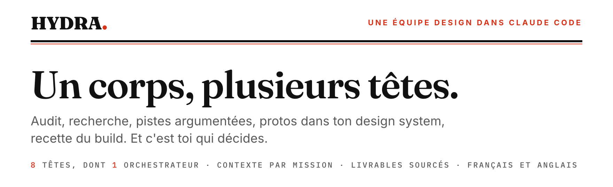
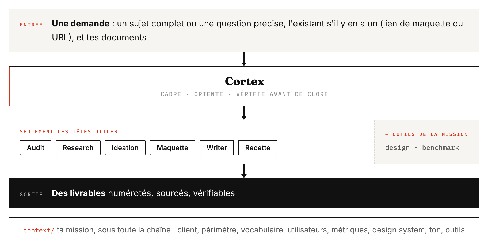

<picture>
  <source media="(prefers-color-scheme: dark)" srcset="docs/assets/banniere-sombre.png">
  
</picture>

<p align="center">
  <a href="https://mcqx7.github.io/hydra-agent/presentation.fr.html"></a>
  <a href="https://github.com/MCQX7/hydra-agent/releases/latest"></a>
  <a href="LICENSE"></a>
  
  
  
</p>

<p align="center"><a href="README.md">English</a> · <b>Français</b></p>

---

Tu donnes un sujet à Hydra : un écran existant, des documents, un problème. Il s'en
occupe de bout en bout. Il audite l'existant, cherche ce qui se fait ailleurs, propose
des pistes et les critique, compose des protos avec ton design system, vérifie les
textes, et sait aussi recetter un build. Il fait le travail d'une petite équipe autour
de toi, et c'est toi qui décides.

Il ne te dit pas ce que tu veux entendre. Si une idée est faible, il le dit et explique
pourquoi. Chaque affirmation cite sa source. S'il manque des données, il le dit au lieu
d'inventer.

## Comment ça marche

<picture>
  <source media="(prefers-color-scheme: dark)" srcset="docs/assets/flux-sombre.png">
  
</picture>

Cortex cadre ta demande et n'appelle que les têtes dont elle a besoin. L'audit et la
recherche font la phase de discovery : l'audit regarde ton existant, la recherche
regarde ce qui se fait ailleurs.

## Ce qu'un sujet produit

| Livrable | Ce qu'il contient |
|---|---|
| `01-fiche` | Le cadrage : le problème, l'indicateur qui tranchera et son seuil, les personnes touchées, le périmètre, les rendus (mobile, desktop) et ce qui est déjà décidé. |
| `02-rapport` | Les constats sur l'existant, les hypothèses, les références, les pistes avec leur critique, puis la recommandation. Chaque affirmation renvoie à sa source. |
| `03-brief` | Pour chaque piste : ce que l'écran doit montrer, avec quels composants, et un texte de composition que n'importe qui peut reprendre dans son propre outil. |
| `explorations/` | La galerie : un proto HTML par piste, qu'on peut manipuler, dans les rendus de ta plateforme. |
| Recette | Pour le développeur : un tableau par zone de l'écran, en desktop et en mobile, avec la valeur attendue, la valeur mesurée sur le build, la sévérité et une capture annotée. |

Tu choisis comment le sujet se déroule. **D'un trait** : Hydra va jusqu'au bout et note
ce qu'il a dû supposer. **Par étapes** : il s'arrête aux moments clés pour que tu
tranches. Pour les protos, qui coûtent le plus, tu choisis aussi le moment : **tout de
suite**, ou **après avoir lu le brief**, si les pistes en valent la peine. Hydra te pose
ces deux questions au cadrage.

## La langue

Hydra travaille dans ta langue. Il te parle et écrit ses livrables dans la langue de
travail de ta mission : celle dans laquelle tu lui écris, que l'accueil note avec toi.
Dans le doute, il prend le français. En anglais, tout passe en anglais :
les titres, les noms des livrables (`01-topic-sheet`, `02-report`, `03-brief`) et les
pages rendues. Dans une autre langue, le texte est dans ta langue et les titres restent
en anglais.

Les textes des protos, eux, suivent la langue de ton produit, qui peut être une autre.
La méthode reste écrite en français (les règles, les têtes, les messages des outils),
mais tu n'as pas à la lire.

## Démarrer

**Il te faut :**
- **Claude Code**, idéalement avec **Opus**. Hydra est réglé pour Opus en effort élevé
  (la recette en effort moyen), d'après des tests comparés. Il marche aussi avec Sonnet
  ou un effort plus bas si ton abonnement ne permet pas mieux, mais ses livrables sont
  alors moins bons.
- **Node.js 22** ou plus récent, et **Google Chrome** (ou Chromium). Les outils sont des
  scripts Node sans rien à installer : ils capturent les protos et mesurent le build.
- **Les outils de ta mission**, si tu en as, branchés comme connecteurs MCP dans Claude
  Code : un outil de design pour lire les maquettes, un outil de benchmark pour voir des
  écrans de vrais produits. Si tu n'as pas d'outil de benchmark, l'accueil te propose
  Lazyweb, qui est gratuit. Aucun outil n'est obligatoire. Tu donnes leur nom, Hydra
  trouve comment les brancher. Si ton outil d'analytics est branché, Hydra va chercher
  lui-même les chiffres qui lui manquent. Sinon, il lit les exports que tu déposes dans
  un sujet.

**Ensuite, deux façons de l'installer.** Les deux font tourner la même méthode.

### En plugin (conseillé)

Hydra s'installe comme un plugin de Claude Code, pour le seul dossier de ta mission. Il
n'apparaît dans aucun autre dossier. Ton contexte et tes sujets vivent dans ce dossier.

1. Crée un dossier vide pour ta mission, par exemple `hydra-ma-mission`, et ouvre le
   Terminal dedans.
2. Installe Hydra pour ce dossier :
   ```
   claude plugin marketplace add MCQX7/hydra-agent
   claude plugin install hydra@hydra-agent --scope local
   ```
   La première commande présente Hydra à Claude Code, une fois par machine. La seconde
   l'installe pour ce dossier seulement.
3. Lance `claude` dans ce dossier et écris **« je viens d'installer Hydra »**. Hydra te dit
   ce qu'il va poser ici, et le pose si tu es d'accord : ses règles (`CLAUDE.md`, qu'il
   tient à jour, n'y touche pas), ses réglages (Opus, effort élevé, et l'écart des
   `CLAUDE.md` des dossiers au-dessus), les modèles de ton contexte et le dossier de tes
   sujets. Il ne s'installe que dans un dossier vide. Si le dossier contient déjà autre
   chose, il ne touche à rien et t'explique quoi faire.
4. Quitte, puis relance `claude` dans le même dossier. Les règles d'Hydra ne se chargent
   qu'à l'ouverture d'une session.
5. L'accueil reprend. Il t'explique comment Hydra fonctionne et remplit le contexte avec
   toi : ta mission, ta langue, tes outils, ton design system, tes utilisateurs.
6. Donne-lui ton premier sujet. Crée `topics/<nom>/inputs/`, mets-y tes documents, et
   écris par exemple : « Audit de [sujet] : [lien de la maquette ou URL de prod].
   Déroule. »

**Pour une nouvelle mission**, refais la même installation dans un nouveau dossier vide
(étapes 1 à 5). La première commande de l'étape 2 n'est plus utile.

**Pour mettre à jour**, tape `claude plugin update hydra@hydra-agent --scope local` dans
le Terminal, depuis le dossier de ta mission. À la session suivante, Hydra réécrit les
règles du dossier et te dit « Hydra vient d'être mis à jour : relance la session pour
charger les nouvelles règles ». Il faut relancer parce que Claude Code lit les règles
avant que le plugin ne les réécrive. Ton contexte et tes sujets ne bougent pas.

### En copie

La méthode est copiée dans ton dossier de travail, comme en 1.x. Pour la mettre à jour,
tu remplaces ses fichiers (voir le CHANGELOG, « Passer de la 1.x à la 2.0 »).

1. Récupère Hydra, comme tu préfères :
   - **sans rien installer** : en haut de cette page, bouton vert **Code**, puis
     **Download ZIP**. Décompresse le dossier où tu veux ;
   - **en une commande**, dans le Terminal, depuis le dossier où tu veux le mettre :
     `npx degit MCQX7/hydra-agent hydra`. Un dossier `hydra` est créé ;
   - **avec git**, si tu t'en sers : `git clone https://github.com/MCQX7/hydra-agent.git`.

   Ouvre ensuite une session Claude Code à la racine de ce dossier.
2. Écris **« je viens de lancer Hydra »**. L'accueil t'explique comment Hydra fonctionne,
   pose les modèles vides du contexte et les remplit avec toi : ta mission, ta langue,
   tes outils, ton design system, tes utilisateurs.
3. Donne-lui ton premier sujet, comme en plugin.

Tu peux avoir les deux sur la même machine : le plugin n'existe que dans les dossiers où
tu l'as installé.

Le contexte n'a pas besoin d'être complet le premier jour. À chaque cadrage, Hydra
demande ce qui manque, te propose de l'ajouter, et ne l'écrit qu'avec ton accord.

<details>
<summary><b>Écarter tes autres fichiers d'instructions</b> (à faire si tu as un <code>CLAUDE.md</code> personnel ou dans un dossier au-dessus)</summary>

Claude Code charge dans chaque session ton `CLAUDE.md` personnel (`~/.claude/CLAUDE.md`)
et ceux des dossiers au-dessus. Ils se mélangeraient à la méthode d'Hydra. En plugin, le
dossier de mission écarte dès sa création ceux qu'il trouve au-dessus de lui. En copie,
ou pour un fichier ajouté plus tard, écarte-les dans `.claude/settings.local.json`
(un fichier qui n'est jamais versionné) :

```json
{
  "claudeMdExcludes": [
    "/chemin/absolu/vers/le/dossier/parent/CLAUDE.md"
  ]
}
```

Mets un chemin par fichier à écarter. Un motif comme `**/mon-dossier/CLAUDE.md` marche
aussi. Le `CLAUDE.md` d'Hydra, lui, doit rester chargé. L'accueil le vérifie avec toi, et
si tu ajoutes plus tard un `CLAUDE.md` sans l'écarter, Hydra te le signale à la session
suivante.
</details>

## Demander une seule chose

Tout n'est pas un sujet complet. Hydra choisit les têtes d'après ta demande, tu n'as pas
à les nommer. Il s'arrête au livrable que tu as demandé et te propose la suite, sans
l'enchaîner tout seul.

| Tu demandes | Ce que tu reçois |
|---|---|
| « Audite cette page », « trouve les points de friction de ce parcours » | La fiche et le rapport : constats priorisés, hypothèses, références, actions. |
| « Quels sont les meilleurs patterns pour… », « les bonnes pratiques de… » | Un livrable de recherche court, avec les écrans en images et les liens vers les sources. |
| « Que disent les études sur… », sur une question précise | Un livrable de recherche : ce que les études, les articles et les guides établissent, et ce que ça change pour ton sujet. |
| Un benchmark ou un état de l'art approfondi | La fiche et un livrable de recherche complet, avec des produits visités en direct. |
| « Challenge cette idée », « aide-moi à trancher » | La fiche et le rapport : les pistes, leur critique, une recommandation. |
| « Quel libellé pour… », « relis ces textes » | Des variantes argumentées, directement dans la conversation. |
| « Est-ce conforme à la maquette ? » | La recette : la liste des corrections pour le développeur. |

## Les têtes

| Tête | Ce qu'elle fait |
|---|---|
| `hydra-accueil` | À la première session, explique Hydra et remplit le contexte avec toi. |
| `hydra-cortex` | Orchestre le sujet : cadrage, déroulé, pauses, clôture. En dehors de la fiche, il n'écrit aucun livrable. |
| `hydra-audit` | Évalue ton existant, une page en ligne ou une maquette, et le croise avec tes documents. Il en tire des constats et des hypothèses. |
| `hydra-research` | Cherche ce qui se fait et ce qui est prouvé ailleurs : écrans de vrais produits, produits visités, design systems publics, études. Chaque référence est sourcée et datée. |
| `hydra-ideation` | Ouvre des pistes, les critique, puis choisit sur des critères explicites. |
| `hydra-maquette` | Compose les pistes en protos HTML, avec les composants de tes librairies. |
| `hydra-writer` | Vérifie les textes des protos par rapport à ta charte de ton, ou au ton de ton produit. |
| `hydra-recette` | Compare la maquette au build, chiffres à l'appui, pour le développeur. |

## Comment c'est rangé

Trois couches, qui ne se mélangent jamais :
1. **La méthode** : les règles (`CLAUDE.md`), les têtes `hydra-*` et les outils
   (`.tools/`). Elle ne contient rien d'un client et elle est la même pour tous. En
   plugin, elle vit dans le plugin, et ton dossier de mission ne garde qu'une copie des
   règles, qu'Hydra tient à jour. En copie, elle vit dans ton dossier (`CLAUDE.md`,
   `.claude/skills/hydra-*`, `.tools/`).
2. **Le contexte**, dans `context/` : tout ce qui est propre à ta mission. Changer de
   mission, c'est remplacer ce dossier.
3. **Les sujets**, dans `topics/<nom>/` : un dossier par sujet, avec ce que tu déposes et
   ce qu'Hydra produit. Un sujet terminé se range dans `topics/.archive/`.

## Ce qu'Hydra ne fait pas

- Pas de recherche utilisateur. Il ne mène ni entretiens ni tests, mais il exploite ceux
  que tu lui donnes.
- Il ne modifie jamais ta maquette dans l'outil de design. Il la lit, et compose ses
  protos à part, en HTML.
- La recette est visuelle : elle ne couvre ni l'accessibilité ni les tests fonctionnels.
- Pas de contenu marketing long. Writer s'occupe des textes d'interface.
- Il n'invente ni composant, ni valeur, ni convention. Ce qui manque, il le signale.

<details>
<summary><b>Les outils, et ce qui casse sans eux</b></summary>

Les outils sont branchés par le plugin (en copie, par les réglages du dossier) et
tournent tout seuls. Si l'un d'eux ne se lance pas, Hydra le signale une fois, sans
bloquer.

| Outil | Ce qu'il fait | Sans lui |
|---|---|---|
| `md-to-html.js` | Transforme chaque livrable markdown en page HTML lisible, et le contrôle au passage (sigles non définis, références, gras, titres du gabarit), en français comme en anglais. | Pas de page HTML, aucun contrôle des livrables. |
| `lexique.js` | Les titres et les mots des livrables que les contrôles reconnaissent, en français et en anglais. | Les contrôles ne reconnaissent plus rien et le disent. |
| `proto-frame.js` | Assemble la galerie des protos d'un sujet, vérifie que chaque piste a son proto et que ses boutons réagissent. | Pas de galerie, et une piste sans proto passe inaperçue. |
| `proto-shot.js` | Capture chaque proto dans les rendus que demande la fiche du sujet, pour que la tête voie ce qu'elle a composé. | La tête ne voit pas son rendu : un texte qui déborde ou deux blocs qui se chevauchent passent. |
| `rendus.js` | Lit dans la fiche du sujet les rendus demandés (mobile, desktop ou les deux). | Tous les protos sortent en mobile et en desktop. |
| `hydra-qa-gate.js` | Contrôle de fin de tour. Il bloque tant que des captures neuves n'ont pas été regardées, ou que les compteurs d'une recette ne tombent pas juste. | Un proto corrigé peut partir sans avoir été revu. |
| `hydra-mesure.js` | Relève les vraies valeurs du build (tailles, couleurs, positions) pour la recette. | La recette ne peut pas chiffrer ses écarts. |
| `hydra-bilan.js` | Signale pendant la session un document déposé jamais lu, une recherche faite hors de research, la lecture d'un autre sujet, ou un fichier d'instructions étranger. | Ces oublis passent sans que personne ne les voie. |
| `hydra-dossier.js` | En plugin : crée le dossier de mission, met ses règles à jour à chaque ouverture de session, et fait taire les outils hors d'un dossier de mission. | Pas de dossier de mission, et après une mise à jour, d'anciennes règles sans que rien ne le dise. |
| `hydra-render.html`, `vendor/` | Le gabarit des pages de livrables, et la bibliothèque qui convertit le markdown (marked, licence MIT). | Rien ne s'affiche. |
</details>

## Règle d'or

Aucun contenu client dans la méthode : ni nom, ni chiffre, ni exemple tiré d'une
mission. Tout ce qui est propre à une mission vit dans `context/` et dans `topics/`.

## Versions

Ce qui change d'une version à l'autre, et comment mettre à jour sans toucher à ton
contexte ni à tes sujets : [CHANGELOG.md](CHANGELOG.md).

## Licence

[MIT](LICENSE). Tu peux l'utiliser, le modifier et le redistribuer librement, à condition
de garder la mention de copyright et de licence.
